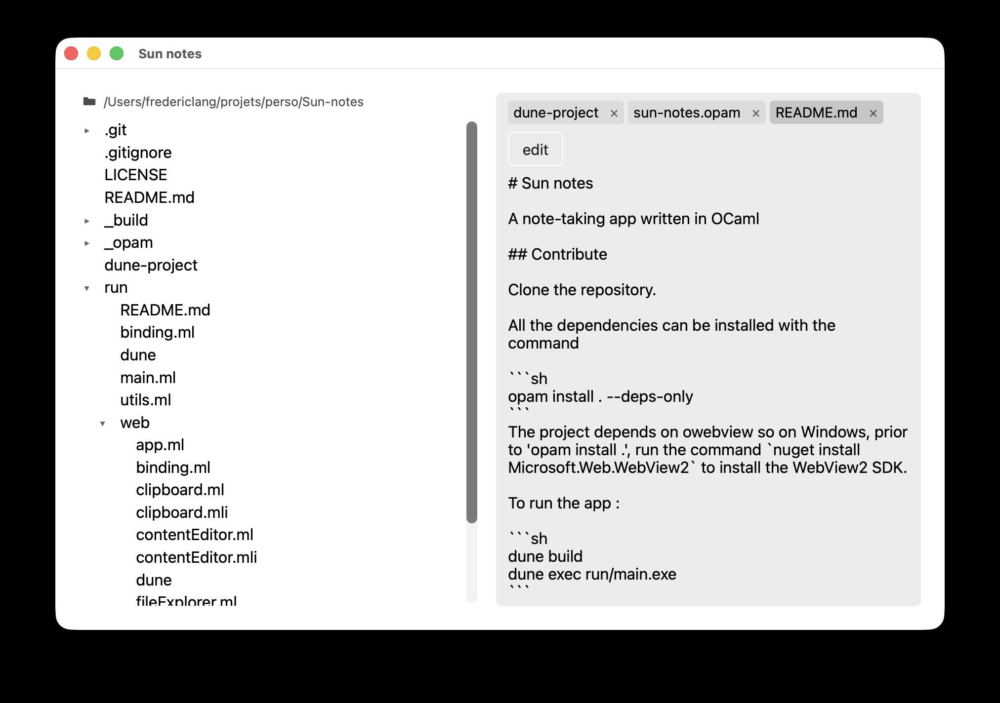

[Sun notes](https://github.com/korkorran/Sun-notes) is a small note-taking application:
browse a directory as a tree, open several files at once as tabs, edit them and write
them back. It is written entirely in OCaml, on both sides — the window is a native one
rendered by the system web engine through
[owebview](https://github.com/korkorran/owebview), and the page inside it is OCaml too,
compiled to JavaScript with `js_of_ocaml` and driven by
[ocaml-vdom](https://github.com/LexiFi/ocaml-vdom).

The [previous article](/posts/2026-09-08-owebview-a-solution-for-ocaml-guis/) made the
case for that design. This one is what it looks like once a real application is built on
top of it.

## The shape of the project

```
run/
├── main.ml            opens the window, registers the bindings, starts the loops
├── binding.ml         the native side of the bridge
├── utils.ml           utilities to de-stringify bindings arguments
├── dune
└── web/               
    ├── index.html       an empty shell; the markup comes from view
    ├── style.css
    ├── app.ml           the assembly
    ├── fileExplorer.ml  the file explorer widget
    ├── contentEditor.ml the content editor widget
    ├── clipboard.ml     clipboard utility
    ├── binding.ml       the renderer side of the bridge
    └── dune
```

Two dune executables, then, in one directory tree: a native one and a `(modes js)` one.
The split is the interesting part. Everything that touches the filesystem —
listing a directory, reading a file, writing it back, creating a new one — lives in the
native `binding.ml` and is exposed to the page as a function it can call. Everything the
user sees lives under `web/`. 

## Two panes, two widgets

The interface is two columns, and each one is a self-contained widget with its own
model, its own message type, its own update and its own view.

**`fileExplorer`** owns the whole of browsing. It roots a tree on a directory — your home
directory by default, or any path you type into it — expands and collapses directories as
you click them, reads the file you select, creates new ones where you ask for them, and
reports whatever the native side failed at. Nothing else in the application knows how a
directory is listed or what an entry looks like.

**`contentEditor`** owns the whole of editing. It holds several files at once, one tab
each, and keeps track of what each contains, whether it is being viewed or edited,
whether it still matches what is on disk, and how its last save went. It writes files
back itself, so the rest of the application never has to know when a save happens.

Together they are the two main panels of the application:



## Putting them together

`app.ml` is assembly, and almost nothing else. It holds one model of each widget, and
wraps each one's messages in a constructor of its own so that the two message types can
never mix. An incoming message is forwarded to the widget it belongs to; whatever that
widget produces comes back wrapped the same way. The view places the two rendered
panes side by side.

What is left is the coupling between them, and it is deliberately one single thing: the
explorer has a file in hand and something else has to display it. Rather than reach for
the editor itself, the explorer reports it upwards, and `app.ml` is what turns that report
into an instruction for the editor. Neither widget knows the other exists — each could
be dropped into a different application, or replaced, without the other noticing.

## Why Vdom

Three things made it the right library for this.

**It is light.** The compiled page is 128 KB of JavaScript, and the whole release build of
Sun notes — native binary, page and assets — fits in a 2.5 MB application bundle. No
runtime is shipped alongside it and no engine is bundled: the page is rendered by the one
the operating system already has.

**The Elm architecture keeps the application legible.** A model, a message type, an update
function and a view that is a pure function of the model. Nothing looks up a DOM node by
hand or mutates one; `Vdom_blit` diffs the tree that `view` returns and patches the
document itself. The consequence is that the whole of what the application can do is
readable as a list of message constructors, and the whole of what it shows is readable as
one function.

**It composes.** Because a widget is just those four pieces, it can be built in
isolation and mapped into a larger one — which is exactly what `fileExplorer` and
`contentEditor` are. Two independent widgets, each understandable on its own, assembled by
a file that does little more than route messages between them.
